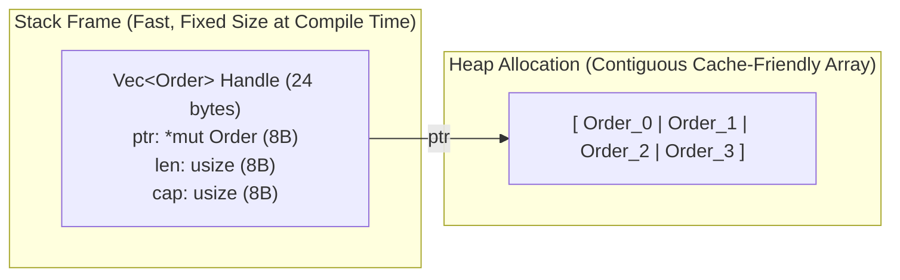

# `rust-zero-drift` — Zero-Drift Systems Rust Architecture, Compiler Guardrails & Pure-Rust Force-Multiplier Codex

> **Core Thesis:** When building deterministic systems—or orchestrating AI coding agents—the highest-leverage guardrail is making invalid states, silent arithmetic drift, and lazy shortcuts **physically uncompilable**.
>
> `rust-zero-drift` pairs a **compilable `#![forbid(unsafe_code)]`, 0-dependency reference library ([`src/lib.rs`](src/lib.rs))**, hardened **[`Cargo.toml`](Cargo.toml) + [`clippy.toml`](clippy.toml) compiler guardrails**, an **Antigravity 2.0 Agent Skill ([`SKILL.md`](SKILL.md))**, and a **20-Domain Pure-Rust Force-Multiplier Codex** into a single reference repository.

---

## Repository Contents

| Artifact | Purpose |
| :--- | :--- |
| **[`src/lib.rs`](src/lib.rs)** | Zero-dependency, `#![forbid(unsafe_code)]` Rust 2024 reference implementations of: **(1)** Validated `#[repr(transparent)]` fixed-point Newtypes (`BoundedScalar`), **(2)** Zero-Cost Typestate Workflows (`Command<Unchecked> -> Command<Verified> -> Command<Committed>`), **(3)** ABA-immune `GenerationalArena<T>` (`NodeKey`), and **(4)** Sans-IO Deterministic `SafetyGovernor`. |
| **[`Cargo.toml`](Cargo.toml) & [`clippy.toml`](clippy.toml)** | Drop-in production compiler & linter configuration enforcing `unsafe_code = "forbid"`, pedantic Clippy rules, banned `.unwrap()`/`.expect()`/`todo!()`/lossy `as` casts, fast incremental dev builds (`debug = "line-tables-only"`), and `lto = "fat"` release tuning. |
| **[`SKILL.md`](SKILL.md)** | Ready-to-use **Google Antigravity 2.0 / Agent Skill** enforcing the 4-Stage Zero-Drift Rust Engineering Workflow and bridging hot-loop verification into **[REA-Argonaut](https://github.com/PNWcoastie/REA-Argonaut)**. |

---

## Part I: The Systems Programming Mental Model (The "Why It Works" Refresher)

When Rust "locks everything into strict compartments where nothing can drift off-script," four compile-time mechanisms under the hood make that happen:

### 1. Memory Layout: Stack, Heap, Alignment & Repr

In Rust, values live on the **Stack** (or inline inside their parent struct/Vec) by default. Nothing goes on the **Heap** unless you explicitly put it inside a smart pointer (`Box<T>`, `Vec<T>`, `Arc<T>`, `String`).



#### Controlling Exact Byte Layout (`#[repr(...)]`)
By default (`repr(Rust)`), the compiler automatically **reorders struct fields** to eliminate wasted padding bytes between differently sized fields. When you need manual control:

| Attribute | What It Does | When to Use It |
| :--- | :--- | :--- |
| **`#[repr(C)]`** | Keeps fields in the exact order you wrote them using C ABI padding rules. | FFI boundaries, network/disk headers, GPU buffers. |
| **`#[repr(transparent)]`** | Wraps a single field (`struct UserId(u64);`) with **zero runtime wrapper overhead**—identical in memory and CPU registers to the inner type. | Type-safe IDs ("Newtype pattern") so you can never pass an `OrderId(u64)` where an `AccountId(u64)` is expected. |
| **`#[repr(align(64))]`** | Forces the struct to sit on a 64-byte CPU cache-line boundary. | Preventing **false sharing** between threads mutating adjacent atomics/counters. |
| **`#[repr(u8)]` / `#[repr(u32)]`** | Forces an `enum` discriminant tag to have an exact integer byte width. | Binary wire protocols and hardware registers. |

#### Niche Optimization (Zero-Cost `Option`)
In most languages, making a pointer nullable or wrapping a value in `Optional<T>` adds extra bytes or a heap allocation. Rust detects **invalid bit patterns ("niches")** and hides the `None` tag inside them for free:
- `size_of::<&T>()` == **8 bytes**
- `size_of::<Option<&T>>()` == **8 bytes** (because a valid reference can never be `0x0`, Rust uses `0x0` to represent `None`!)
- Same for `Option<Box<T>>`, `Option<NonZeroU64>`, and `Option<bool>`.

---

### 2. Ownership, Borrowing & The Aliasing Matrix

Every bug in C++/Python/JS state management comes from **Shared Mutable State** (two things pointing to the same data while at least one of them is mutating it). Rust enforces **Affine Types** (a value is moved by default and can only have one owner) and the **XOR Rule**:

$$\text{Any number of } \texttt{\&T} \text{ (Shared Read-Only)} \quad \mathbf{XOR} \quad \text{Exactly one } \texttt{\&mut T} \text{ (Exclusive Read/Write)}$$

#### When You *Need* Shared Mutation: The Interior Mutability Matrix
Sometimes a compartment *must* be shared across multiple handles while still updating internal state (like a cache, metrics counter, or hardware bus). Rust forces you to pick the exact contract:

| Type | Thread-Safe? | Cost | How It Enforces the Contract |
| :--- | :--- | :--- | :--- |
| **`Cell<T>`** | Single-thread (`!Sync`) | **Zero cost** (just moves/copies `T` in and out, no references handed out) | Best for numbers/enums/booleans inside a single-threaded struct. |
| **`RefCell<T>`** | Single-thread (`!Sync`) | Tiny runtime borrow counter (`isize`) | Moves the `&T XOR &mut T` check from compile time to runtime; panics if violated. |
| **`AtomicU64` / `AtomicBool`** | Multi-thread (`Sync`) | Hardware CPU atomic instructions | Lock-free concurrent counters, flags, and sequence numbers. |
| **`Mutex<T>` / `RwLock<T>`** | Multi-thread (`Sync`) | OS/futex lock (`parking_lot` is fastest) | In Rust, **the lock wraps the data** (`Mutex<State>`), not the code. You *cannot* touch `State` without locking it first. |
| **`OnceLock<T>` / `LazyLock<T>`** | Multi-thread (`Sync`) | Initialized once, lock-free reads forever after | Global configs, compiled regexes, or static lookup tables. |
| **`Cow<'a, T>`** | Depends on `T` | **Clone-on-Write** | Borrows read-only data (`&'a T`) for free; only allocates/clones if you actually mutate it. |

---

### 3. Lifetimes (`'a`) Without the Headache

A lifetime annotation (`'a`) **never changes how long a value lives**. It is purely a **compile-time proof label** connecting the lifetime of an output borrow to the lifetime of an input owner.

```rust
// Read `'a` as: "The returned slice `&'a str` is guaranteed not to outlive `buffer`"
fn parse_symbol<'a>(buffer: &'a [u8]) -> &'a str { ... }
```

#### The 4 Lifetime Rules Worth Remembering
1. **Borrow vs. Owned (`&str` vs `String`, `&[T]` vs `Vec<T>`):**
   - Pass `&str` or `&[T]` into functions when you only need to *inspect* data (zero allocation, works on slices of buffers).
   - Store owned `String` or `Vec<T>` inside long-lived structs unless you are deliberately building a **zero-copy parser** where the struct borrows straight from a network packet buffer.
2. **The Two Meanings of `'static`:**
   - **`&'static str` (A Static Reference):** The data is baked into the binary (or leaked) and valid for the entire program run.
   - **`T: 'static` (A Static Trait Bound):** Often misunderstood! This does *not* mean `T` lives forever—it simply means *"T owns all of its data and contains no temporary `&'a` borrows."* (Any `String`, `Vec<u8>`, or owned `struct` satisfies `T: 'static`, which is why `tokio::spawn` requires `T: 'static`).
3. **Higher-Ranked Trait Bounds (`for<'a>`):**
   - Written `F: for<'a> Fn(&'a Packet) -> Decision`. It means: *"This closure must work for **any** temporary borrow lifetime `'a` I hand it during execution."*
4. **`Pin<&mut T>` (Pinned Memory):**
   - Used under the hood by `async`/`await`. Because Rust moves values around in memory by copying bytes (`memcpy`), an `async fn` state machine that holds a pointer to one of its own local variables cannot be moved in memory once started. `Pin` locks its memory address in place.

---

### 4. Generics, Traits & Zero-Cost Abstractions

When people talk about Rust's **Zero-Cost Abstractions**, they mean you can write high-level generic code (`iter().map().filter().sum()`) and the compiler compiles it down to the **exact same machine instructions** (or better, via SIMD auto-vectorization) as a hand-rolled C `for` loop.

#### Static Dispatch vs. Dynamic Dispatch

| Feature | Static Dispatch (`<T: Strategy>` or `impl Strategy`) | Dynamic Dispatch (`&dyn Strategy` or `Box<dyn Strategy>`) |
| :--- | :--- | :--- |
| **How it compiles** | **Monomorphization:** Compiler generates a dedicated, specialized copy of the function for each concrete type `T`. | **Fat Pointer (`16 bytes`):** `[8B data_ptr, 8B vtable_ptr]`. Looks up the method at runtime via the vtable. |
| **Runtime Speed** | **Maximum.** Functions are inlined right into the caller; zero pointer indirection; CPU branch predictor loves it. | Tiny overhead (1 pointer dereference + blocks compiler inlining across the trait boundary). |
| **When to use** | Hot loops, numeric kernels, pipelines where the concrete types are known at compile time. | Heterogeneous collections (`Vec<Box<dyn Plugin>>`) or plugin registries decided at runtime. |

#### The Auto-Marker Traits (Compiler Security Guards)
- **`Send`:** Safe to transfer ownership of this type across thread boundaries.
- **`Sync`:** Safe for multiple threads to hold `&T` shared references at the same time (`T` is `Sync` if and only if `&T` is `Send`).
- **`Copy`:** Value can be duplicated by a simple bit-for-bit stack copy (integers, floats, small `[repr(C)]` structs). If a type is *not* `Copy`, assignment `let b = a;` **moves** `a` and invalidates the old binding.
- **`Sized`:** Type has a known byte size at compile time (all types except slices `[T]`, `str`, and `dyn Trait`, which must sit behind a pointer like `&[T]` or `Box<dyn Trait>`).

---

## Part II: The 20-Domain Pure-Rust Force-Multiplier Stack

### 1. Native UI, GPU Engines, TUI & Custom HUD Bricks (Zero JS Required)

| Crate / Engine | Architecture Style | Best Used For |
| :--- | :--- | :--- |
| **`iced`** | **Elm State Machine** (`State` + `enum Message` -> `update` -> `view`) | Desktop apps, control panels, and dashboards where you want your UI locked into the exact same strict `enum` state-machine mental model as your backend. |
| **`slint`** | **Compiled Declarative UI** (`.slint` files compile ahead-of-time into native Rust structs; zero runtime interpreter) | Industrial control panels, hardware/robotics touchscreens, `no_std` embedded displays (`< 300KB` RAM), and desktop apps replacing C++ Qt/QML. |
| **`gpui` (by Zed)** | **120–240Hz Video-Game-Grade GPU UI** (hybrid entity handles + immediate layout rendered 100% on GPU shaders) | Pro-grade developer tools, ultra-low-latency trading terminals, and dense multi-pane workspaces where a 1-frame drop is unacceptable. |
| **`egui`** | **Immediate Mode GUI** (redraws directly from your Rust structs at 60–144Hz) | Ultra-fast live debuggers, simulation/game overlays, live parameter tuners, and low-latency native tools. |
| **`makepad`** | **Shader-Driven Live-Hybrid UI** (every widget is a customizable GPU pixel shader with millisecond live-reload) | Futuristic HUDs, local AI studio interfaces (`Moly`), synth/audio workstations, and cross-platform Desktop/Mobile/Wasm/VR apps. |
| **`floem`** | **Fine-Grained Reactive Native GUI** (`RwSignal<T>` updates only the exact widget node via `wgpu`/`tiny-skia`) | Complex data-heavy desktop apps where you want reactive signals without Virtual DOM diffing or an HTML WebView. |
| **`xilem` + `vello`** | **GPU Compute-Shader Vector UI** (typed reactive views rendered by `Vello` 2D compute shaders on `wgpu`) | High-density vector graphics, node-graph editors, CAD/map viewers, and infinite canvases. |
| **`freya` / `vizia`** | **Skia-Backed Reactive (`freya`) & Audio-Grade Declarative (`vizia`)** | Pixel-identical cross-platform Skia desktop apps (`freya`) and zero-jitter VST3/CLAP audio plugin UIs (`vizia`). |
| **`rerun`** | **Multimodal Telemetry Engine** (built on `egui` + `wgpu` + Arrow) | Streaming 2D/3D point clouds, robotics transforms, camera feeds, and high-frequency time-series charts with a few lines of Rust. |
| **`ratatui`** | **Terminal UI (TUI)** | 120fps Bloomberg-style terminal dashboards, SSH-friendly server/bot monitors, and CLI control centers. |
| **`dioxus` / `leptos`** | **Fine-Grained Reactive Signals** (WebAssembly / Desktop / Mobile) | Full-stack web or cross-platform apps written 100% in Rust (both server functions and client UI share the exact same Rust types). |
| **`tauri`** | **Rust Native Core + OS Webview** | When you want a tiny (`~5MB`) native binary with a Rust backend without bundling a 200MB Electron Chromium instance. |
| **`winit` + `tiny-skia` + `cosmic-text` + `sctk`** | **Low-Level Custom HUD & Wayland Layer-Shell Bricks** | Building floating, transparent, always-on-top desktop HUDs and pill overlays (`smithay-client-toolkit` / `gtk4-layer-shell` on Wayland, `tiny-skia` SIMD 2D rasterizer, `cosmic-text` subpixel font shaping). |

---

### 2. Zero-Copy Serialization & High-Speed Memory IO

| Crate | What Makes It a Force Multiplier |
| :--- | :--- |
| **`rkyv`** | **True Zero-Copy Deserialization.** Instead of parsing JSON/Protobuf into newly allocated structs, `rkyv` guarantees the byte layout on disk/network *is already the in-memory Rust struct*. Reading a 1GB file or IPC message takes **0 nanoseconds of parsing and 0 heap allocations**. |
| **`zerocopy` / `bytemuck`** | Compile-time checked traits (`FromBytes`, `IntoBytes`, `Pod`) that prove a `#[repr(C)]` struct has zero padding bytes or invalid bit patterns—allowing safe, 0-cost casting between `&[u8]` byte slices and `&MyStruct`. |
| **`memmap2`** | Cross-platform memory-mapped files (`mmap`). Pair `memmap2` + `rkyv` or `zerocopy` to treat a 100GB file on NVMe SSD as an instant in-memory Rust slice `&[Record]`. |
| **`bytes`** | Reference-counted, sliceable byte buffers (`Bytes` / `BytesMut`) that let you split and pass packet payloads across channels with zero copying. |
| **`postcard`** | Ultra-compact binary `serde` format originally built for bare-metal microcontrollers; ideal for low-bandwidth wire protocols. |

---

### 3. Concurrency, Lock-Free Pipelines & Async Runtimes

| Crate | What Makes It a Force Multiplier |
| :--- | :--- |
| **`tokio`** | The industry-standard work-stealing async runtime for network I/O, timers, gRPC (`tonic`), and HTTP (`axum` / `reqwest`). |
| **`monoio` / `glommio`** | **Thread-per-Core `io_uring` Runtimes.** Pins one thread per CPU core with zero cross-thread lock contention and kernel-bypass I/O for ultra-low tail latency. |
| **`rayon`** | Turn any sequential iterator `.iter()` into a multi-core work-stealing parallel iterator just by changing one word to **`.par_iter()`**—with compile-time guarantees of zero data races. |
| **`rtrb` / `ringbuf`** | **Wait-Free SPSC (Single-Producer Single-Consumer) Ring Buffers.** Pass millions of messages per second between a network/sensor thread and a real-time engine thread with zero locks and zero allocations. |
| **`crossbeam`** | Lock-free MPMC channels (`crossbeam-channel`), scoped threads (that can borrow stack variables without `'static`), and epoch-based lock-free memory reclamation. |
| **`dashmap`** | High-throughput concurrent `HashMap` sharded across CPU cores. |

---

### 4. Native AI, ML Inference, GPU Compute & Linear Algebra

| Crate | What Makes It a Force Multiplier |
| :--- | :--- |
| **`candle`** | Hugging Face's pure-Rust ML framework. Load `.safetensors` or quantized `.gguf` models (LLMs, Whisper, Vision models) into a single static Rust binary with CUDA/Metal/CPU acceleration and **zero Python dependency**. |
| **`burn`** | Full deep-learning training and inference framework written in pure Rust with pluggable backends (`wgpu`, CUDA, LibTorch, NdArray). |
| **`ort`** | Production Rust bindings for ONNX Runtime—drop a trained PyTorch/XGBoost/scikit model exported as `.onnx` straight into a microsecond Rust hot loop. |
| **`cubecl` / `wgpu`** | Write portable GPU compute shaders directly in Rust that run across NVIDIA, AMD, Apple Silicon, and WebGPU. |
| **`faer` / `nalgebra`** | Pure-Rust linear algebra and matrix solvers. `faer` frequently outperforms C/Fortran OpenBLAS and C++ `Eigen` on matrix decompositions while staying 100% Rust. |

---

### 5. Formal Verification, Fuzzing & Deterministic Simulation

| Crate / Tool | What Makes It a Force Multiplier |
| :--- | :--- |
| **`kani`** | **Mathematical Model Checker for Rust.** Proves using SAT/SMT solvers that a critical function (like a risk limit, state machine, or binary parser) can *never* panic, overflow, or violate an invariant across **100% of all possible inputs**. |
| **`proptest`** | Property-based testing: instead of testing 3 hardcoded examples, generate 10,000 adversarial inputs and automatically **shrink** any failing case down to the smallest possible reproduction. |
| **`turmoil`** | **Deterministic Network & Time Simulation.** Simulates an entire cluster of async nodes on a single thread with a virtual clock and injectable packet drops/partitions—turning flaky network bugs into 100% reproducible unit tests. |
| **`loom`** | Exhaustively permutes every possible OS thread interleaving of your atomic/lock-free code to mathematically prove there are no race conditions. |
| **`divan` / `criterion`** | Nanosecond-precision statistical micro-benchmarking (plus exact heap allocation counting in `divan`). |

---

### 6. Data Engines, Embedded Storage & Search

| Crate | What Makes It a Force Multiplier |
| :--- | :--- |
| **`polars` / `datafusion`** | Pure-Rust, SIMD-accelerated Apache Arrow columnar DataFrame and SQL query engines. Embed a full analytical database engine inside your binary. |
| **`redb` / `fjall`** | 100% pure-Rust embedded ACID key-value storage engines (replacing C's LMDB and C++'s RocksDB with zero C++ build scripts). |
| **`sqlx`** | Connects to Postgres/SQLite at **compile time** during `cargo check` and fails your build if your SQL query has a typo or returns a column type that doesn't match your Rust struct! |
| **`tantivy`** | Pure-Rust full-text search engine (the Rust equivalent of Apache Lucene, 2–10x faster and tiny memory footprint). |

---

### 7. Robotics, Hardware, Embedded & Polyglot Bridges

| Crate | What Makes It a Force Multiplier |
| :--- | :--- |
| **`dora-rs` / `copper-rs`** | Deterministic, zero-copy pure-Rust robotics and embodied AI middleware (replaces heavy C++ ROS2 stacks with sub-microsecond shared-memory dataflow). |
| **`zenoh`** | Pure-Rust pub/sub/storage protocol uniting cloud, edge, and microcontrollers with a fraction of DDS/MQTT overhead. |
| **`embassy`** | Write bare-metal microcontroller firmware (`no_std` on STM32, ESP32, RP2040, nRF) using clean Rust `async`/`await` with zero RTOS needed. |
| **`pyo3` + `maturin`** | Compile any Rust crate into a native Python `import my_rust_engine` wheel in one command (`maturin develop`). |
| **`wasmtime` / `extism`** | Embed a capability-locked WebAssembly sandbox inside your Rust host to execute untrusted plugins or AI-generated code with nanosecond startup and zero host filesystem access. |

---

### 8. Novel Type-Level Guardrails, Zero-Copy Parsing & Safe SIMD

| Crate | What Makes It a Force Multiplier |
| :--- | :--- |
| **`nutype`** | **Newtypes with Compile-Time & Construction Guarantees.** Write `#[nutype(validate(finite, greater = 0.0))] pub struct Price(f64);` and it becomes physically impossible anywhere in your codebase to construct a `Price` that is `NaN`, `Infinity`, or `<= 0.0`. |
| **`bon`** | **Compile-Time Checked Builders.** Add `#[bon::builder]` to any struct or function: if you forget to set a required field, or set the same field twice, **it fails at compile time**, not runtime. |
| **`rust_decimal` / `fixed`** | **Deterministic 128-bit Decimal & Fixed-Point Math.** Eliminates IEEE-754 floating-point drift (`0.1 + 0.2 != 0.3`) completely for financial engines, order books, and deterministic simulations. |
| **`winnow` / `chumsky`** | **Declarative Zero-Copy Parser Combinators.** Instead of regex gibberish or hand-rolled byte loops, compose small type-safe functions that parse wire protocols, DSLs, or logs at `memcpy` speed. |
| **`pulp` / `wide`** | **100% Safe Portable SIMD.** Write `f64x4` or auto-dispatched AVX2 / AVX-512 / NEON vectorized loops while keeping `#![forbid(unsafe_code)]` enabled. |
| **`enum_dispatch`** | Replaces `Box<dyn Trait>` vtable dynamic dispatch with an automatically generated `enum` wrapper—giving you **10x faster static dispatch** across a closed set of types with a single macro attribute. |
| **`schemars`** | Automatically generates strict JSON Schemas from your Rust `struct` and `enum` definitions (`#[derive(JsonSchema)]`)—the ultimate bridge for forcing LLMs/agents to return only valid Rust types. |

---

### 9. eBPF Kernel Telemetry & Line-Rate Packet Filtering

| Crate | What Makes It a Force Multiplier |
| :--- | :--- |
| **`aya`** | **100% Pure-Rust eBPF (Kernel + User Space).** Write both your kernel-space eBPF/XDP programs and user-space loader in pure Rust sharing the exact same `#[repr(C)]` structs—no BCC or C headers needed. |
| **XDP (`aya_ebpf::programs::XdpContext`)** | Inspect, filter, route, or drop network packets **at the NIC driver level** before the Linux kernel even allocates a socket buffer (`sk_buff`)—processing tens of millions of packets per second per core. |
| **`pnet` / `smoltcp`** | Pure-Rust raw packet construction and standalone user-space TCP/IP stack (for kernel-bypass, bare-metal, or custom VPN/tunnel protocols). |

---

### 10. Cryptography, EVM / DeFi Engines & Zero-Knowledge Proofs (zkVMs)

| Crate | What Makes It a Force Multiplier |
| :--- | :--- |
| **`alloy` & `revm`** | **The High-Speed EVM Stack.** `alloy` is the modern, high-speed replacement for `ethers-rs`; `revm` is an embeddable, ultra-fast pure-Rust Ethereum Virtual Machine used to simulate millions of on-chain state transitions and MEV bundles locally in microseconds. |
| **`sp1` (Succinct) & `risc0`** | **Rust Zero-Knowledge Virtual Machines (zkVMs).** Write normal, standard Safe Rust code, and the zkVM generates a **cryptographic mathematical proof (ZK-STARK / SNARK)** that your Rust code ran honestly on private inputs—without revealing the inputs! |
| **`plonky3` / `arkworks` / `halo2`** | Low-level finite-field arithmetic and zero-knowledge circuit construction in pure Rust. |
| **`rustls` / `ring` / `aws-lc-rs`** | Memory-safe TLS and audited cryptographic primitives replacing OpenSSL C vulnerabilities. |
| **`zeroize`** | `#[derive(Zeroize, ZeroizeOnDrop)]` guarantees that private keys, API secrets, and sensitive buffers are physically overwritten with zeroes in RAM the instant the struct goes out of scope (preventing compiler dead-store optimization from skipping the wipe). |

---

### 11. Entity-Component-Systems (ECS) & Deterministic Physics Simulations

| Crate | What Makes It a Force Multiplier |
| :--- | :--- |
| **`bevy_ecs` / `hecs`** | **Standalone Cache-Linear ECS.** You can import `bevy_ecs` *without* the game engine as a tiny standalone crate! Stores entities in contiguous Structure-of-Arrays (SoA) tables and automatically schedules non-conflicting queries across CPU cores in parallel. |
| **`rapier3d` / `rapier2d` & `parry`** | **100% Pure-Rust Physics & Collision Detection.** Replaces C++ PhysX/Bullet/Box2D with a cross-platform **bit-deterministic** rigid-body, joint, and raycasting engine written entirely in Rust. |
| **`glam`** | Ultra-fast SIMD-aligned 2D/3D math (`Vec3A`, `Quat`, `Mat4`) used across the Rust simulation ecosystem. |

---

### 12. High-Speed Browser Automation, Scraping & Anti-Bot Networking

| Crate | What Makes It a Force Multiplier |
| :--- | :--- |
| **`rquest` / `impit`** | **TLS / JA3 / JA4 / HTTP2 Browser Fingerprint Emulation in Rust.** Drop-in `reqwest`-style async HTTP clients that mimic exact Chrome/Safari/Firefox BoringSSL cipher suites, ALPN extensions, and HTTP/2 frame ordering at native Rust speed. |
| **`lol_html` (by Cloudflare)** | **Streaming `O(1)` Memory HTML Parser & Rewriter.** Parses and extracts CSS selectors from gigabytes of HTML on the fly as bytes stream off the socket without ever building a heavy DOM tree in RAM. |
| **`chromiumoxide` / `fantoccini`** | Pure-Rust async Chrome DevTools Protocol (CDP) and WebDriver orchestration for driving headless browser pools at scale. |

---

### 13. Real-Time Audio, SDR (Software-Defined Radio) & DSP

| Crate | What Makes It a Force Multiplier |
| :--- | :--- |
| **`cpal` + `rtrb`** | Low-latency cross-platform audio I/O paired with wait-free ring buffers so the real-time audio thread never allocates or blocks. |
| **`fundsp` / `dasp`** | Composable, zero-allocation digital audio synthesis and sample-frame signal processing graphs. |
| **`rustfft` / `realfft`** | Pure-Rust SIMD-accelerated Fast Fourier Transforms. |
| **`futuresdr`** | Async, multi-core Software-Defined Radio (SDR) and RF DSP runtime in pure Rust (modern replacement for C++/Python GNU Radio). |

---

### 14. Real-Time Gateways, Bot Orchestration & Event Automation (`twilight` Stack)

| Crate | What Makes It a Force Multiplier |
| :--- | :--- |
| **`twilight` (`twilight-gateway`, `twilight-http`, `twilight-standby`, `twilight-cache-inmemory`)** | **The Modular, Zero-Bloat Discord Ecosystem.** Unlike monolithic frameworks, `twilight` decouples gateway shard concurrency, selective in-memory caching, and REST/webhook dispatch—and `twilight-standby` lets you `await` specific live user reactions, component clicks, or modal submissions directly as a typed stream. |
| **`poise`** | Strongly-typed Discord slash-command, context-menu, and sub-command macro framework when rapid command routing is needed alongside `serenity`. |
| **`teloxide`** | Industrial-grade Telegram automation framework featuring a built-in **compile-time Dialogue State Machine (`teloxide::dispatching::dialogue`)** that models multi-turn user workflows as an exhaustive Rust `enum`. |
| **`matrix-sdk`** | Pure-Rust Matrix real-time chat and automation SDK with native `vodozemac` end-to-end encryption. |
| **`notify` / `watchexec`** | Cross-platform OS kernel filesystem event watcher (`inotify` on Linux, `FSEvents` on macOS, `ReadDirectoryChangesW` on Windows) for sub-millisecond local automation triggers. |

---

### 15. High-Frequency WebSockets, QUIC & Financial Wire Protocols (FIX / SBE)

| Crate | What Makes It a Force Multiplier |
| :--- | :--- |
| **`fastwebsockets` (by Deno) & `tokio-tungstenite`** | `fastwebsockets` is an ultra-fast, zero-copy RFC-6455 WebSocket frame parser/client/server that reuses buffers across frames for high-frequency tick and gateway streams. |
| **`quinn` & `s2n-quic` (by AWS)** | Pure-Rust QUIC and HTTP/3 implementations providing 0-RTT handshakes and multiplexed streams with zero TCP head-of-line blocking. |
| **`tower`** | Composable `Service` middleware pipeline (`RateLimit`, `ConcurrencyLimit`, `LoadShed`, `Timeout`, `Retry`, circuit breakers) wrapping any HTTP, gRPC, or custom socket transport in mathematical backpressure. |
| **`fefix` (FastEngineFIX) / `hotfix`** | Pure-Rust **FIX Protocol (`4.2`/`4.4`/`5.0`)**, FAST, and **SBE (Simple Binary Encoding)** engines for direct low-latency institutional exchange connectivity. |

---

### 16. Stack-Inline Strings, SIMD JSON & Hot-Path Collections (Zero-Allocation Primitives)

| Crate | What Makes It a Force Multiplier |
| :--- | :--- |
| **`compact_str` / `smol_str`** | Stores strings up to **24 bytes directly on the stack** inside the 24-byte string header (`0` heap allocations for ticker symbols, Discord snowflakes, UUIDs, or status codes!). |
| **`smallvec` / `arrayvec`** | `SmallVec<[Order; 8]>` lives 100% on the stack and only spills to the heap if a burst exceeds 8 elements. |
| **`lasso`** | Thread-safe string interner that converts repeated strings (exchange symbols, guild/channel IDs, log tags) into a `Copy` 32-bit `Spur` key so string equality becomes a 1-cycle `u32 == u32`. |
| **`sonic-rs` & `simd-json`** | AVX2/NEON SIMD-accelerated JSON engines. `sonic-rs` supports **lazy path extraction (`get_from_slice`)**—pulling a single nested field out of a 50KB WebSocket JSON payload without parsing or allocating the rest of the JSON. |
| **`ahash` / `rustc-hash` (`FxHashMap`) & `roaring`** | 3x faster non-cryptographic hardware-assisted hash maps for internal state tables, plus `roaring` compressed bitmaps for nanosecond set intersections. |
| **`lz4_flex` & `aho-corasick`** | `lz4_flex` is a 100% `#![forbid(unsafe_code)]` multi-GB/s LZ4 compressor; `aho-corasick` matches 10,000 keywords across a byte stream in a single `O(n)` SIMD pass. |
| **`ulid` & `uuid` (`v7`)** | 128-bit **monotonic, timestamp-ordered unique IDs** (`Copy`, `Ord`, `16 bytes` on stack) that sort chronologically in B-Tree storage engines without random page fragmentation. |

---

### 17. Native OS Automation, Input Synthesis, Screen Capture & Hardware Telemetry

| Crate | What Makes It a Force Multiplier |
| :--- | :--- |
| **`enigo` & `rdev` / `evdev`** | Cross-platform keyboard/mouse input synthesis and low-level global hotkey/input interception (`evdev`/`uinput` on Linux, Quartz Event Tap on macOS, `SendInput` on Windows). |
| **`xcap` / `scap`** | High-FPS cross-platform screen, monitor, and window frame capture in pure Rust (PipeWire/X11/Wayland, macOS ScreenCaptureKit, Windows DXGI Desktop Duplication). |
| **`arboard` (by 1Password)** | Cross-platform clipboard inspection and injection supporting both UTF-8 text and raw RGBA image buffers. |
| **`global-hotkey` & `tray-icon`** | Native OS system-tray menus and global keyboard shortcuts with zero browser overhead. |
| **`sysinfo` & `nvml-wrapper`** | Real-time CPU, RAM, process tree, disk, and live NVIDIA GPU (`libnvidia-ml` VRAM, temperature, power, utilization) telemetry in pure Rust. |

---

### 18. Actor Frameworks, Supervision Trees & Durable Job Queues

| Crate | What Makes It a Force Multiplier |
| :--- | :--- |
| **`kameo` & `ractor`** | Async-native Erlang-style **Actor & Supervision Tree** frameworks built on Tokio with bounded mailboxes, backpressure, and automatic fault-isolated actor restarts. |
| **`apalis` & `tokio-cron-scheduler`** | Strongly-typed background job queues (backed by SQLite, Postgres, or Redis with exponential backoff retries and dead-letter queues) and in-process async cron scheduling. |

---

### 19. Pure-Rust Image Processing, Media & Instant PDF Typesetting

| Crate | What Makes It a Force Multiplier |
| :--- | :--- |
| **`fast_image_resize` & `image`** | AVX2/NEON SIMD-accelerated image scaling, color-space conversion, and lossless 24-bit `.webp`/`.png` encoding that outperforms C/Python Pillow for vision pipelines. |
| **`typst`** | Pure-Rust programmable typesetting engine (100x faster than LaTeX) embeddable as a Rust library to compile data-driven PDF tearsheets, reports, and documents in milliseconds. |

---

### 20. Next-Gen `cargo` Subcommands & Profilers

| Tool | What It Does |
| :--- | :--- |
| **`cargo-mutants`** | **Tests Your Tests (Especially AI-Written Tests!).** Automatically mutates your Rust source code behind the scenes (flips `>` to `>=`, `+` to `-`, drops a line) and checks if your tests fail. If all tests still pass when a line is mutated, it tells you the exact edge case your tests missed. |
| **`cargo-show-asm` (`cargo asm`)** | Inspect the exact x86_64/ARM assembly or LLVM IR generated for any single Rust function (`cargo asm my_crate::hot_loop`). Instantly see if a loop auto-vectorized into SIMD or if a hidden bounds-check panic (`panic_bounds_check`) snuck in. |
| **`dhat` (`dhat-rs`)** | **Zero-Allocation Proof Testing.** Profiles every heap allocation and lets you write unit tests that assert `assert_eq!(stats.total_blocks, 0)`—proving a hot path allocates 0 bytes on the heap. |
| **`insta` (`cargo insta`)** | Snapshot testing for complex Rust structs, state transitions, and parser outputs with an interactive terminal diff reviewer (`cargo insta review`). |
| **`tokio-console`** | `htop` for async Rust: live terminal dashboard showing every spawned task, poll durations, waker storms, and deadlocks in real time. |
| **`cargo-nextest`** | Drop-in replacement test runner (`cargo nextest run`) that runs tests in isolated parallel processes up to 3x faster and detects flaky/hanging tests cleanly. |
| **`cargo-deny` & `cargo-semver-checks`** | Audits your entire dependency tree for security advisories, banned duplicate crates, license issues, and accidental semver breakage. |

---

## Part III: 6 High-Leverage Rust Architectural Patterns

### Pattern 1: The Typestate Pattern (Making Illegal Workflows Uncompilable)
Encode workflow states directly into the type system using zero-sized types (`PhantomData`). Because transition methods take `self` **by value** (consuming the old state), it is physically impossible to call `.commit()` on an unverified command—see [`src/lib.rs`](src/lib.rs) for the complete compilable implementation.

### Pattern 2: Generational Arena Indices (Beating the Borrow Checker on Graphs)
Whenever you build a simulation, UI tree, or robotics graph where "everything needs to reference everything," **do not use `Rc<RefCell<Node>>` or raw pointers**. Store nodes in a flat [`GenerationalArena`](src/lib.rs) or `slotmap::SlotMap` and pass lightweight `Copy` keys (`NodeKey`) around—guaranteeing cache-contiguous memory and immunity to ABA use-after-free bugs.

### Pattern 3: Multi-Crate "Sans-IO" Workspace Architecture
Once a project grows past ~2,000 lines, split your workspace into **3 strict layers** where the core engine has **zero network/async/database dependencies** ("Sans-IO"):

```text
my-project/
├── Cargo.toml                 # [workspace] root with centralized [workspace.dependencies] & [workspace.lints]
├── clippy.toml                # Workspace-wide AI & human guardrails
└── crates/
    ├── domain-types/          # Pure structs, Newtypes, Typestates, Errors (0 I/O deps; compiles in ~0.2s!)
    ├── core-engine/           # Deterministic state machine: `fn on_event(&mut self, ev: Event) -> Action`
    ├── io-adapters/           # Tokio, WebSockets, SQLite/Postgres, HTTP, Hardware serial/CAN
    └── app-cli-or-gui/        # Thin binary entrypoint wiring `io-adapters` into `core-engine`
```

### Pattern 4: Structured Error & Diagnostics Architecture (`thiserror` vs `miette` / `error-stack`)
Never use `Box<dyn std::error::Error>` or raw `String` errors. Enforce a strict two-tier error contract:
1. **Inside Domain & Engine Crates (`thiserror`):** Every module defines an exhaustive, machine-matchable `enum EngineError` so callers can programmatically `match` on exact failure modes.
2. **At the Binary / CLI / Report Boundary (`miette` or `error-stack`):** Render compiler-grade diagnostic reports with source spans or attach typed context frames across layers.

### Pattern 5: Zero-Config Cross-Compilation & Single-Binary Packaging
- **`cargo-zigbuild`:** Uses the Zig linker under the hood to cross-compile from any host to **macOS (`aarch64-apple-darwin`)**, **Windows (`x86_64-pc-windows-gnu`)**, or **Static Linux (`x86_64-unknown-linux-musl`)** in one command:
  ```bash
  cargo zigbuild --release --target x86_64-unknown-linux-musl
  ```
- **`rust-embed` / `include_bytes!`:** Bakes static folders (HTML/Wasm assets, shaders, lookup tables) directly into the `.rodata` section of your compiled Rust binary in release mode.

### Pattern 6: Production Compiler & Linter Hardening
See [`Cargo.toml`](Cargo.toml) and [`clippy.toml`](clippy.toml) in this repository for the full drop-in configuration.

---

## Part IV: The Antigravity + Rust Agentic Playbook & [REA-Argonaut](https://github.com/PNWcoastie/REA-Argonaut) Bridge

### 1. Eliminating the 5 Classic AI-Agent Rust Blind Spots
1. **Rust 2024 Idioms Over Legacy Crates:** Standard library `std::sync::LazyLock` / `OnceLock` over `lazy_static!`/`once_cell`; native `async fn` in traits over `#[async_trait]` heap boxing; flat `let ... else` guards over nested `match` pyramids.
2. **Async Cancellation-Safety & Bounded Backpressure:** Bounded `tokio::sync::mpsc::channel(cap)` only (never `unbounded_channel()`); cancellation-safe `tokio::select!` branches; structured `CancellationToken` + `TaskTracker` shutdowns.
3. **Secret Hygiene:** `secrecy::SecretString` + `zeroize` for all credentials and startup-validated `figment` + `clap` configs.
4. **Fast Incremental Dev Builds:** `debug = "line-tables-only"` and `[profile.dev.package."*"] opt-level = 2`.
5. **Types Over Macro Magic:** Generics, traits, and `const fn` over opaque `macro_rules!` DSLs.

### 2. Bridging Into [REA-Argonaut](https://github.com/PNWcoastie/REA-Argonaut) Subagents
When a greenfield Rust project includes hot numeric/DSP/crypto kernels, binary parsers, or external model weights, [`SKILL.md`](SKILL.md) routes directly into the 4 **[REA-Argonaut](https://github.com/PNWcoastie/REA-Argonaut)** specialists:
- **`safe-rust-reconstructor`:** Authors zero-unsafe, overflow-checked (`checked_*` / `wrapping_*`), cache-aligned hot kernels.
- **`adversarial-parity-auditor` (`verify_rust_parity`):** Runs 10,064 SplitMix64 + boundary seeds against a reference C oracle (`c_source_code` mode) inside an OS sandbox with coordinate-wise binary-search counterexample shrinking.
- **`subgraph-architect`:** Audits compiled `target/release` Rust binaries via `inspect_rust_cpp_binary` and `decompile_subgraph` to inspect surviving `core::panicking::Location` branches and verify third-party `-sys` FFI libraries contain zero `latent_hazards`.
- **`forensic-vertical-specialist`:** Streams `.gguf`, `.safetensors`, `.onnx`, `.pcap`, and SQLite headers in `< 50 ms` so Rust type definitions match binary schemas on the first compile.

---

## Verification

```bash
cargo clippy --all-targets -- -D warnings
cargo test
```

---

## License

Copyright (c) 2026 [PNWcoastie](https://github.com/PNWcoastie) / JadedRose. All Rights Reserved. See [LICENSE](LICENSE) for details.
